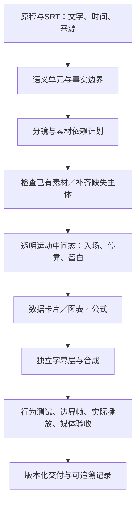

# 工程思想与架构

这个项目把教育讲解视频拆成可追溯的内容计划、静态素材、按帧运动、数据图层和验收记录。核心目标是让画面解释当前稿件中的关系，同时让一次局部修改能够单独验证、另存版本并回归比较。

第一次使用可先读本文，再按[从SRT到成片](从SRT到成片.md)做一段短片；查找或新增图像时读[素材与动效复用](素材与动效复用.md)。仓库中的 `examples/layered-explainer/` 用于理解分层实现，`material-library/` 用于浏览和选择图像。示例中的演示数据不能用于现实教育判断。工程资料的使用条件见[根目录LICENSE](../LICENSE)。

## 1. 先确定要解释什么

一条字幕通常只是语言停顿，不一定构成完整镜头。先把相邻字幕合成能够表达一个完整意思的语义单元，再确定画面的主动作：比较、通过条件、对应、汇聚、变化或选择。

每个主要人物、物件、数字、公式和路径都应能回答两个问题：它对应哪句来源？它让观众更容易理解哪种关系？已有素材只能帮助实现这个解释，不能反过来决定稿件的含义。通用书本可以承载“资料”的角色，但文件名不能证明现实中的教材、政策或资格条件。



这个依赖顺序有实际作用：先检查人物是否挡住数据区，再制作图表；先核对数字的单位和分母，再确定图形。若素材运动中间态已经依赖完整图表才能成立，就难以独立定位构图问题。

## 2. 用几份职责明确的记录连接内容与代码

| 记录 | 负责回答的问题 |
| --- | --- |
| `production-brief.json` | 用哪些字幕与语义单元？每个镜头解释什么？元素的证据状态是什么？如何承接前后镜头？ |
| `asset-plan.json` | 哪些素材可复用、需生成或适合代码绘制？依赖顺序是什么？主体和数据分别占哪里？ |
| 素材目录与检查结果 | PNG字节、透明状态、可见边界、锚点、提示词、适用语义和限制是什么？ |
| `production-run.json` | 本次实际检查了什么？哪一版获得何种范围的认可？交付文件和哈希是什么？还有哪些检查未完成？ |

`production-brief.json` 使用仓库既有契约，包括 `captions`、`semanticUnits`、`visualElements`、`scenes`、`sampleDecision` 和 `verificationItems` 等字段；具体字段以校验器和 schema 为准。素材依赖计划作为伴随文件保存，不向封闭 schema 临时添加字段。详见[内容映射规范](../references/content-to-visual.md)与[生产流程规范](../references/production-workflow.md)。

来源转述准确和来源里的说法真实，是两种不同的判断。未核实的数据保持待核实状态；需要忠实引用时，仍须让出处、范围和不确定性与数字一起可见，不能借“引用”把事实核查标成通过。

## 3. 图层是不同的工程责任

| 图层 | 建议实现 | 边界 |
| --- | --- | --- |
| 背景与光影 | 固定背景、渐变、接触阴影 | 服务于层次，不抢主动作 |
| 解释主体 | 透明PNG或完整场景图 | PNG是静态整体；平移缩放不会产生新姿势或新视角 |
| 主体运动 | 由当前帧计算的位置、缩放、旋转和透明度 | 主体、标注、连线和阴影使用同一份姿态 |
| 数据与公式 | 可编辑文字、SVG、React组件 | 数值与来源精度一致；几何变化不伪造历史过程 |
| 字幕 | 独立字幕层 | 保留原文与时间，换行只改变排版 |

素材运动中间态只检查主体、路径、阴影、停靠和预留空间。随后在同一个数据矩形中接入轻卡片、图表或公式。字幕始终单独合成，不能靠把整张画面缩小来临时腾出字幕区。

## 4. 每一帧都是输入的纯函数

视频状态应满足：

```text
state = evaluate(frame, fps, sourceData, timing, layout)
```

同一组输入必须得到相同状态，无论是从开头播放、直接跳到某帧，还是离线并行渲染。不要依赖上一帧的可变状态、系统时间、定时器、运行时随机数或CSS自主播放动画。Remotion提供当前帧，项目中的纯函数计算进度、姿态和图形，组件只负责呈现结果。

把时序写成可读事件，例如“建立主体 → 移动 → 停靠 → 数据展开 → 阅读停留 → 退出”。共享端点能保证位置承接；有连续运动的地方还要检查速度变化。需要停稳时应明确安排减速和停留，不能只让两段坐标恰好相等。

同一个物件跨多条字幕持续发挥作用时，保留稳定ID和连续姿态。新字幕开始不意味着它必须重新入场。需要切镜时，记录 `continuityAnchor`，检查上一镜退出状态与下一镜进入状态是否兼容。

## 5. 用可见边界定位，用互斥窗口管理替换

透明PNG周围经常有大块空白。按整张图片宽度定位会造成“数值相同、看起来大小不同”。实际位置和尺度应来自非透明主体的可见边界；数学关系与使用方法见[素材与动效复用](素材与动效复用.md#按可见边界定位)。旋转后的外接范围、阴影与移动标签也要纳入碰撞检查。

数据卡片升级成图表时，先关闭同一区域内的旧卡片，再显示新图表。可用半开区间 `[startFrame, endFrame)` 表示各自的可见窗口，并在代码中明确唯一的主内容。过渡叠化如确有需要，应是有意设计并检查过的状态，不能残留旧值、重复标签或两套相互矛盾的图形。

## 6. 数据动起来，事实标签保持准确

历史分数、日期、门槛、已报道人数或比例在入场时显示来源中的准确标签。柱子可以长高，折线可以逐段描绘，扇区可以展开；不要把从零计数的中间数字呈现为历史记录。只有来源本身描述累积，或明确标注为计数演示时，数值递增才有对应语义。

选择图表前先确定关系：一致横轴上的有序观察才用折线，同单位且同范围的类别才作共同比较，有明确整体才用饼图或环形。环形的 `whole` 必须明确：百分比可用 `whole=100` 表达百分比尺度；人数图的整体必须是同单位且有来源的总人数。不能从孤立人数猜分母，也不能把当前出现的部分重新归一化成100%。详见[图表动效规范](../references/chart-motion.md)。

## 7. 可复用的是机制，完成状态需要当前证据

仓库保留的是方法、组件和已选择发布的素材。图像生成需要使用者自己的本地工具或已授权账户；clone和安装依赖不会附送生图服务、账户额度、私有原稿或配音。SRT解析、边界测量与媒体校验可以执行确定性检查，语义规划、事实判断和视觉取舍仍需人或具备相应能力的智能体完成。

一次通过的单元测试、截图或Studio预览都不能单独证明成片完成。修改后运行对应行为检查，最后一次源码修改后做最终回归；检查代表帧和每个边界的两侧，向前播放实际导出视频，再校验最终文件的媒体合同与完整解码。旧版保留，新版单独命名，记录检查范围和未做事项。操作顺序见[从SRT到成片](从SRT到成片.md#验收与版本回归)。
